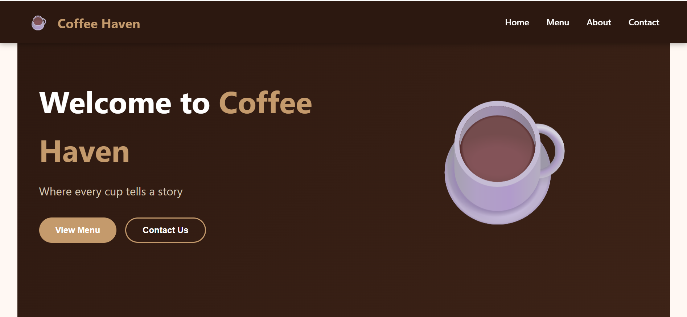
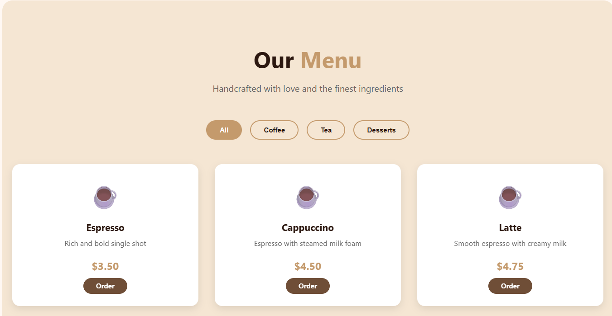
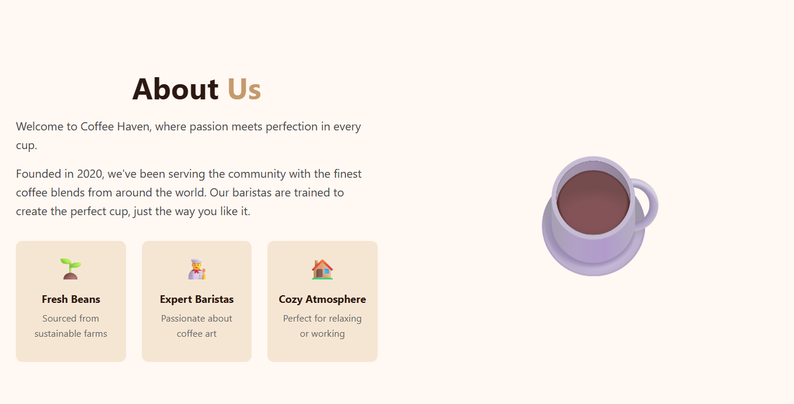
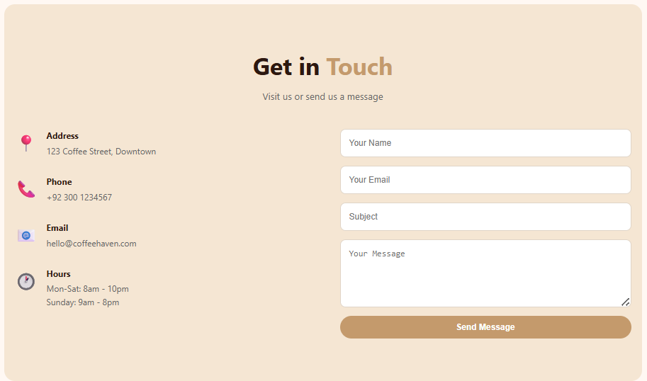

# Coffee Haven ☕

A simple and responsive coffee shop website built using HTML, CSS, and JavaScript. This project was created to practice front-end development and basic Docker deployment.

## Features

- Responsive navigation bar
- Hero section
- Coffee menu with category filter
- About section
- Contact form
- Smooth scrolling
- Toast notifications
- Mobile-friendly design

## Technologies Used

- HTML5
- CSS3
- JavaScript
- Docker
- Nginx

## Project Structure

```text
Coffee-Haven/
│
├── index.html
├── style.css
├── script.js
├── Dockerfile
└── README.md
```

## Run with Docker

Build the Docker image:

```bash
docker build -t coffee-haven .
```

Run the container:

```bash
docker run -d -p 8080:80 coffee-haven
```

Open in your browser:

```
http://localhost:8080
```

## Author

**Muhammad Sheraz**

## Screenshots

### Home Page



### Menu Section



### About Section



### Contact Section

